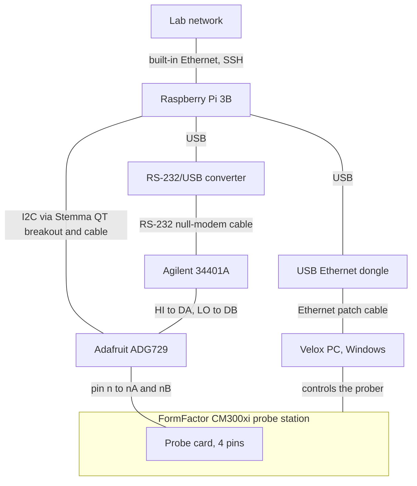

# Hardware

The Pi controls the prober through the dongle and the Velox PC, and reaches the meter over
RS-232 and the mux over I2C; the mux routes the meter's HI and LO to the probe card pins.
The GPIB adapter (a Keysight 82357) is no longer used.

## Devices
| Device | Role |
| --- | --- |
| Raspberry Pi 3B | Orchestrator. Users SSH in and run measurement scripts. |
| USB Ethernet dongle | Second network interface on the Pi, a direct private link to the Velox PC. |
| RS-232/USB converter | Connects a Pi USB port to the 34401A's RS-232 port. |
| Agilent/Keysight 34401A DMM | 6.5-digit meter doing the 2-wire resistance measurement. |
| Adafruit ADG729 breakout | Dual 4:1 matrix switch (8 independent switches) routing the meter to the probe card pins. Default I2C address 0x44. |
| Adafruit Pi Stemma QT breakout + STEMMA QT / Qwiic 4-pin cable | I2C connection from the Pi to the ADG729. |
| FormFactor CM300xi + Velox PC | Probe station and its Windows control PC, which runs Velox. |
| Probe card | 4 pins that touch down on wafer pads. |

## Connections
| From | To | Link | Notes |
| --- | --- | --- | --- |
| Lab network | Pi built-in Ethernet | Ethernet | Users SSH in here. |
| Pi USB port | USB Ethernet dongle | USB | |
| USB Ethernet dongle | Velox PC network port | Ethernet patch cable | Direct private link for prober control. |
| Pi USB port | RS-232/USB converter | USB | |
| RS-232/USB converter | 34401A RS-232 port | RS-232 cable | The meter is a DTE device, so a null-modem (DTE-to-DTE) cable is required (34401A manual). |
| Pi GPIO header | Pi Stemma QT breakout | Header connection | |
| Pi Stemma QT breakout | ADG729 breakout | STEMMA QT / Qwiic 4-pin cable | I2C. |
| 34401A Input HI | ADG729 DA | Wire | 2-wire resistance. |
| 34401A Input LO | ADG729 DB | Wire | 2-wire resistance. |
| ADG729 nA and nB (n = 1 to 4) | Probe card pin n | Wire | Each pin goes to both nA and nB. |
| Velox PC | CM300xi probe station | Existing prober connection | Not changed by this project. |

## Mux wiring
The meter's HI goes to DA and its LO goes to DB, so any probe pin can reach either meter terminal.
- Probe card pin n connects to both nA and nB (n = 1 to 4).
- To measure between pins i and j, close switch iA and switch jB and leave every other switch open.
- Never close iA together with iB: that connects HI to LO through the mux and reads as a false short.

## Network
- Pi built-in Ethernet: lab network (SSH access). USB dongle: direct private link to the Velox PC.
- Private link: static addresses on their own subnet, no gateway. Proposed, not yet set: 192.168.50.1 on the Pi, 192.168.50.2 on the Velox PC.
- Pin the dongle's interface name by MAC address so it survives a change of USB port.
- The Windows firewall rule for the control port should allow only the Pi's address.
- The Velox PC needs a network port that can be addressed directly for this link (open item).

## Not yet verified
- ADG729 switch-bit mapping; see `docs/decisions.md`.
- 34401A open-circuit voltage on the resistance ranges (not in its manual); the ADG729 breakout's analog signals must stay within its supply (3.3 V from the Stemma QT).
- How the 34401A's Input LO is tied to the mux ground.
